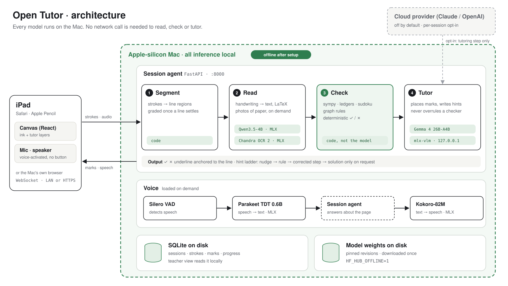

# Open Tutor

An offline AI tutor for work done by hand. A student writes on an iPad (Apple Pencil) or a Mac. The tutor reads the
handwriting, checks every step with code and marks the page the way a teacher would: a small ✓ or ✗ on the exact
line, hints only when asked, never the full solution unprompted. It can listen and talk. Every model runs on one
Apple-silicon Mac, with open weights under open licences. After a one-time download, no internet and no cloud API
are needed.

## Who it's for

Students who can't count on school or the internet: communities with poor connectivity, and places where storms,
floods or heatwaves close schools. They keep practising at home and go to school when they can.

- At least 171 million students had school disrupted by climate events in 2025, and 75% of them were in low- and
  lower-middle-income countries ([UNICEF, *Learning Interrupted*](https://www.unicef.org/reports/learning-interrupted)).
- 2.2 billion people are still offline ([ITU, Facts and Figures 2025](https://www.itu.int/itu-d/reports/statistics/facts-figures-2025/)).

It's also useful to anyone who learns on paper and wants a patient second pair of eyes: maths, accounting, languages
and sudoku. A separate screen tutor (in progress) walks people through desktop software step by step.



## How to run it

**You need:** an Apple-silicon Mac (tested on an M3 Pro with 36 GB of memory), with about 22 GB of memory free for
the tutor model and 30–40 GB of disk for the models. You also need [uv](https://docs.astral.sh/uv/) and Node.js (tested with 22).
An iPad with an Apple Pencil is optional: the canvas also works in a browser on the Mac.

```sh
./setup-local.sh                          # repo-local uv/npm caches (writes uv.toml and apps/web/.npmrc)
cd tutor-app
uv sync && (cd apps/web && npm ci)        # pinned dependencies (uv.lock, package-lock.json)
make models                               # one time, needs internet: pinned open-weight models
make ipad                                 # starts the tutor and prints a QR code: scan it with the iPad and write
```

On the Mac itself, `make build && make server` serves the app at <http://localhost:8000>, which runs with no network
at all. If
there's less memory free, the tutor model runs from an expert-offload store on the SSD instead: slower, but it still
works. `make test`, `make lint`, `make e2e`, `make demo` and `make judge` are described in `tutor-app/Makefile`.

**Optional cloud:** the tutoring step can be switched, per session, to Claude or OpenAI by putting a key in
`tutor-app/.env` (see `.env.example`). Keys live only in `.env`, which is git-ignored. If the cloud call fails, the
app answers with the local model and the page shows "<provider> unavailable — answering locally".

## What expertise is inside, and where it comes from

The model doesn't decide on its own whether a step is right. Most of the teaching is in code and written rules:

- **Checkers** (`tutor-app/apps/server/src/inktutor_server/checkers/`): [sympy](https://www.sympy.org) for algebra and
  calculus steps, arithmetic, double-entry ledger balances for accounting, sudoku rules and graph rules for diagrams.
  A ✗ backed by a checker is a fact, not the model's opinion.
- **How a teacher marks a page** (`ink-tutor/docs/UX.md`): marks are small and anchored to the line they're about. The
  student's ink is never changed. Correct steps get a ✓ and nothing else.
- **Hint ladder:** nudge → rule → the corrected step as "ghost ink" → the full solution, and that last step only if
  the student asks for it explicitly. The prompts are in `tutor-app/apps/server/src/inktutor_server/tutor/prompts/`.
- **Subject modes** (`tutor-app/modes/`): math, accounting, language, sudoku, consulting cases and system design, each
  with its own rubric and prompt.
- **Test pages:** real Apple Pencil recordings of handwritten work, plus synthetic accounting and sudoku pages,
  annotated with what a good tutor should do at each checkpoint (`ink-tutor/fixtures/`).

## Models

All of them run locally through [MLX](https://github.com/ml-explore/mlx). Exact repos and revisions are pinned in
`ink-tutor/models/manifest.toml`.

| Role | Model | License |
|---|---|---|
| Tutor (default) | [Gemma 4 26B-A4B-it](https://huggingface.co/google/gemma-4-26B-A4B-it), QAT 4-bit ([MLX](https://huggingface.co/mlx-community/gemma-4-26B-A4B-it-qat-4bit)) | [Apache-2.0](https://ai.google.dev/gemma/docs/gemma_4_license) |
| Tutor (alternatives) | [Qwen3.6-35B-A3B](https://huggingface.co/Qwen/Qwen3.6-35B-A3B), [Qwen3.8-27B](https://huggingface.co/Qwen/Qwen3.8-27B) | Apache-2.0 |
| Reading handwriting and maths | [Qwen3.5-4B](https://huggingface.co/Qwen/Qwen3.5-4B) | [Apache-2.0](https://huggingface.co/Qwen/Qwen3.5-4B/blob/main/LICENSE) |
| Reading photos of paper | [Chandra OCR 2](https://huggingface.co/datalab-to/chandra-ocr-2) | [OpenRAIL (modified)](https://huggingface.co/datalab-to/chandra-ocr-2/blob/main/LICENSE): has use restrictions, read before reusing |
| Speech to text | [Parakeet TDT 0.6B v3](https://huggingface.co/nvidia/parakeet-tdt-0.6b-v3); [Whisper large-v3-turbo](https://huggingface.co/openai/whisper-large-v3-turbo) for other languages | CC-BY-4.0; MIT |
| Text to speech | [Kokoro-82M](https://huggingface.co/hexgrad/Kokoro-82M) | Apache-2.0 |
| Voice activity | [Silero VAD](https://github.com/snakers4/silero-vad) | MIT |

[mathnote-ocr](https://github.com/YonatanNemtsov/mathnote-ocr) (Apache-2.0) is an optional, experimental stroke-based maths
reader (`math` extra). It isn't used by default.

## Does it work better with our part?

We compare the same model (Gemma 4 26B-A4B, local) on the same handwritten page in two ways. **Without Open Tutor**,
it gets an image of the page and "check my work". **With Open Tutor**, it gets the full pipeline: reading, checkers,
marking rules and the hint ladder. The page is a real Apple Pencil recording of integrals, replayed stroke by stroke
and paused at 4 checkpoints: 2 correct steps and 2 mistakes.

| | Gemma 4 alone | Gemma 4 + Open Tutor |
|---|---|---|
| Behaves like a good tutor (same LLM judge, same expected behaviour) | 1/4 | 4/4 in the latest run; 15/16 over 4 runs |
| Finds the actual wrong step (2 mistake checkpoints) | 0/2: called the wrong integral correct and the correct quotient wrong | 2/2, decided by sympy |
| Marks the exact line on the page | no: a block of text about the whole page | 16/16 checkpoints scored by code (4 runs) |
| Gives away the solution unprompted | 3 of 4 checkpoints | never; only on explicit request |
| Time to first feedback | first words 1.6–2.6 s, full reply 7–14 s | first mark 2.6 s (latest run's median), 2.6–5.3 s across runs |

At the second checkpoint, plain Gemma 4 said: *"Your work for the second integral is correct, but there is a calculation
error in the first integral."* The opposite was true.

Reproduce it with `make judge MODEL=gemma4-26b-a4b` (with Open Tutor) and
`uv run python -m inktutor_server.eval.baseline` (Gemma 4 alone), both run from `tutor-app/`. Reports are written to
`tutor-app/.data/judge/`. This is a small
test: one page, four checkpoints, maths only, and the judge is itself a language model. It shows the approach works;
it isn't a study.

## Where it doesn't work yet

- It needs an Apple-silicon Mac: the tutor model takes about 16 GB of memory, and runs slower from the SSD when less
  is free. That's realistic as one machine per school
  or community hub serving several tablets, not one per student. It doesn't run on phones yet.
- The models are a large one-time download (30–40 GB). After that it's fully offline.
- The evidence above is small, and it hasn't been tested with students yet.
- Speech recognition covers 25 European languages with Parakeet; other languages use Whisper, loaded on demand.
- The screen tutor for software (`ink-tutor/docs/SCREEN-TUTOR.md`) is early work.

## Repository layout

- `tutor-app/`: the app. A FastAPI server (recognition, checkers, tutor agent, voice, model runtime), a React canvas
  (`apps/web`), a shared pydantic/TypeScript protocol (`packages/protocol`), subject modes (`modes/`) and the macOS
  overlay for the screen tutor (`apps/overlay`, Swift).
- `ink-tutor/`: design docs (`docs/`), the model manifest and downloader (`models/`), test fixtures (`fixtures/`), and
  the recorder tool.

## Open-source libraries

Server (Python, pinned in `tutor-app/uv.lock`):
- [MLX](https://github.com/ml-explore/mlx), [mlx-vlm](https://github.com/Blaizzy/mlx-vlm) and
  [mlx-audio](https://github.com/Blaizzy/mlx-audio) (MIT)
- [FastAPI](https://fastapi.tiangolo.com) (MIT), [Uvicorn](https://www.uvicorn.org) (BSD-3)
- [Pydantic](https://docs.pydantic.dev) (MIT), [HTTPX](https://www.python-httpx.org) (BSD-3)
- [SymPy](https://www.sympy.org) (BSD-3), [ANTLR runtime](https://www.antlr.org) (BSD-3)
- [NumPy](https://numpy.org) (BSD-3), [Pillow](https://python-pillow.org) (MIT-CMU)
- [segno](https://github.com/heuer/segno) (BSD-3), [zeroconf](https://github.com/python-zeroconf/python-zeroconf) (LGPL-2.1)
- [Silero VAD](https://github.com/snakers4/silero-vad) (MIT)
- the optional cloud SDKs: [anthropic](https://github.com/anthropics/anthropic-sdk-python) and
  [openai](https://github.com/openai/openai-python) (MIT)

Web (pinned in `tutor-app/apps/web/package.json` and `package-lock.json`):
- [React](https://react.dev) (MIT), [KaTeX](https://katex.org) (MIT)
- the [Caveat](https://fontsource.org/fonts/caveat) font (OFL-1.1)
- [Vite](https://vite.dev), [Vitest](https://vitest.dev), [Playwright](https://playwright.dev), TypeScript and ESLint,
  for development

The iPad pairing uses [cloudflared](https://github.com/cloudflare/cloudflared) (Apache-2.0) for an HTTPS quick tunnel.

## Privacy

Handwriting, voice and progress stay on the Mac. Nothing is sent anywhere unless a session turns on a cloud provider,
and then only the tutoring request goes. When the iPad pairs through the tunnel, a pairing token in the QR code
protects access, and old codes can be revoked (`pair --new-token`).

## Disclaimer

Open Tutor is a learning aid and can be wrong. Treat its marks and hints as a second opinion, not as grading. The
accounting and consulting modes are for practising exercises and are not financial, accounting or business advice.

## License

[Apache-2.0](LICENSE). The models keep their own licences (see [Models](#models)).
