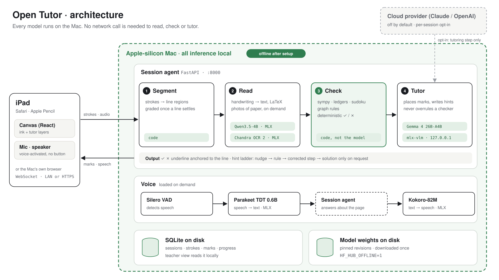

# Design: Open Tutor

- Status: In review
- Last updated: 2026-10-24
- Related: [product.md](product.md) · [requirements.md](requirements.md) · [tasks.md](tasks.md) · full design notes in [ARCHITECTURE.md](../../ink-tutor/docs/ARCHITECTURE.md), [SCREEN-TUTOR.md](../../ink-tutor/docs/SCREEN-TUTOR.md), [MODELS.md](../../ink-tutor/docs/MODELS.md)

## Overview
One Apple-silicon Mac runs a FastAPI server with every model. iPads (Safari) and the Mac's own browser run a React
canvas that sends strokes over a WebSocket and draws the marks the server sends back. The tablet never runs models.
Two tiers: tier 1 reads the ink (Qwen3.5-4B, always local); deterministic checkers decide right or wrong; tier 2
(Gemma 4 26B-A4B by default, local through MLX, optionally a cloud provider) places extra marks, speaks and writes hints.

## Components

| Component | Location (`tutor-app/`) | Responsibility |
|---|---|---|
| Web canvas | `apps/web/src/ink`, `apps/web/src/tutor`, `App.tsx`, `session.ts` | Hand-rolled 2D canvas for ink + SVG tutor layer + HTML popovers (DECISIONS #15); palm rejection; dirty tracker with 700 ms debounce; renders marks, ghost ink (Caveat), question chips, hint popover; KaTeX for tutor maths |
| Start screens | `apps/web/src/ui/start` | Nickname → subjects → problem; nickname kept in `localStorage` |
| Chat column | `apps/web/src/ui/chat` | Typed questions (`chat.text`), transcript of spoken and typed turns, hint-level indicator |
| Voice UI | `apps/web/src/voice` | Mic capture (PCM16 16 kHz), Talk button, playback, mute |
| Pairing UI | `apps/web/src/pairing` | "Pair iPad" dialog with LAN and tunnel QR codes |
| Teacher UI | `apps/web/src/teacher` | Homework list, per-student table, session replay, CSV |
| Protocol | `packages/protocol` (`inktutor_protocol/models.py`) | Pydantic models and wire unions; `schema.json` → `apps/web/src/protocol.gen.ts` |
| HTTP/WS API | `apps/server/src/inktutor_server/app.py` | REST + `/ws/session/{id}` + `/ws/screen/{id}` |
| Ink processing | `inktutor_server/ink/` | Rasterizer, region/line grouping, words, diagram, grid and ledger pre-passes |
| Recognition (tier 1) | `inktutor_server/recognize/` | Reader (Qwen3.5-4B in-process), math/text/diagram/grid/ledger readers, Chandra for photos |
| Checkers | `inktutor_server/checkers/` | `math` (sympy), `arithmetic`, `accounting` (ledger), `sudoku`, `graph` |
| Agent loop | `inktutor_server/agent/` (`agent.py`, `marks.py`, `page_checks.py`) | Per-page state machine; enforces tutor rules in code |
| Tutor (tier 2) | `inktutor_server/tutor/` (`base.py`, `local.py`, `cloud.py`, `prompts/`) | One interface (`review`, `hint`, `converse`, `summarize`, `plan`, `locate`, `explain`); LocalMLX, Anthropic, OpenAI |
| Runtime / models | `inktutor_server/runtime/` (`manifest.py`, `memory.py`, `runtime.py`) | Starts/supervises mlx-vlm, memory policy, offload, lazy tier 1, Chandra on demand |
| Modes | `tutor-app/modes/<name>/`, `inktutor_server/modes.py` | Config (recognizer, checkers, marks), rubric, prompt per subject |
| Voice | `inktutor_server/voice/` (`engine.py`, `session.py`) | Silero VAD → Parakeet STT (Whisper for other languages) → converse → Kokoro TTS |
| Pairing | `inktutor_server/pairing.py`, `pair.py` | Cloudflare quick tunnel, token + HttpOnly cookie, Bonjour, QR |
| Teacher | `inktutor_server/teacher.py`, `progress.py` | Homework, learning log from stored events, summaries |
| Screen tutor | `apps/overlay` (Swift/AppKit), `inktutor_server/screen/`, `ax/`, `guide/` | Overlay helper; frames + AX snapshots; planner, stepper, locator |
| Evaluation | `inktutor_server/judge.py`, `eval/baseline.py`, `apps/server/tests/judge.md` | `make judge`, plain-model baseline |

## Data flow: ink to marks
1. The student lifts the pen. After 700 ms the client sends `ink.update {page_id, strokes_changed, strokes_removed}`.
2. The agent cancels any review in flight, stores strokes in SQLite, and groups strokes into regions/lines (`ink/`).
3. A line is read once it settles (2.5 s idle or the pen moves to another line). Tier 1 reads the rasterized crop and returns `reading` with confidence and alternatives.
4. Low-confidence lines → `feedback` of type `question`; the line waits for `question.answer` or `line.correction`.
5. Mode checkers run on new/changed lines → `CheckResult`s → immediate `feedback` marks (✓, or ✗ + underline on the wrong segment).
6. One tier-2 `review` call per page (at most one in flight) with crops, reading, checker results, problem/rubric and prior feedback. It may add marks on lines no checker decides, a short `speak`, and prepared hint text (stored, not shown).
7. Code drops events with unknown anchors, refuses `hint_level 4` without an explicit request, and limits unprompted `speak` to 20 words.
8. `hint.request {line_id|feedback_id, level}` → cached hint or a `hint` call → `feedback` (hint text, ghost ink at level 3).
9. Spoken or typed questions (`voice.audio`, `chat.text`) → `Tutor.converse` with the page context → `speak` feedback (TTS only when voice is on).

## Wire protocol
JSON over WebSocket, one object per message, discriminated by `type`.

| Direction | Message | Purpose |
|---|---|---|
| client → server | `ink.update` | Changed and removed strokes |
| | `hint.request` | Next hint level for a line or mark |
| | `question.answer` | Answer to a reading question chip |
| | `line.correction` | Student's correction of a reading |
| | `mark.dismiss` | Dismiss a mark or ghost ink |
| | `session.update` | Provider, local model, voice on/off |
| | `voice.audio`, `voice.stop`, `voice.dictate` | Mic audio, end of speech, dictation into a correction |
| | `chat.text` | Typed question (1–1000 chars) |
| server → client | `session` | Session state |
| | `reading` | Tier-1 reading of a page (versioned) |
| | `feedback` | `FeedbackEvent` (mark, ghost, hint, question, speak, explain, summary, retract) |
| | `status` | Page phase (recognizing, checking, reviewing, …) |
| | `voice.transcript`, `voice.audio` | STT partials/finals, TTS audio |
| | `runtime` | Model load/offload state, provider badge data |
| | `error` | Plain-language error |
| helper → server (`/ws/screen/{id}`) | `screen.hello`, `ax.snapshot`, `screen.frame`, `input.event`, `guide.goal`, `guide.control` | Screen tutor perception and control |
| server → helper | `overlay`, `screen.config`, `guide.plan`, `guide.status` | Highlights/captions, config, plan and progress |

REST: `POST /api/sessions`, `GET /api/sessions/{sid}`, `POST /api/sessions/{sid}/photos`, `GET|PUT /api/settings`,
`GET /api/status`, `GET /api/pairing`, `/api/teacher/*` (homework CRUD, sessions, summary, `export.csv`),
`GET /api/homework/{hid}`, `/api/screen/*`, `GET /healthz`.
The schema snapshot is guarded by `packages/protocol/tests/test_schema_snapshot.py`.

## Storage
SQLite (`inktutor_server/store.py`), JSON payloads per row:
`sessions`, `pages`, `strokes` (with `removed` flag and sequence), `readings` (latest version per page),
`feedback` (with provider and model), `homework`, `activity` (per-line events for the learning log), `summaries`
(cached by log hash). Photos and rasters are files next to the database. Nothing is stored off the Mac.

## Runtime and memory
- `LOCAL_MODEL` selects a `[tier2.*]` entry in `ink-tutor/models/manifest.toml`; default `gemma4-26b-a4b` (DECISIONS #25). Only one tier-2 model is resident.
- Full residency only with `memory_gb` + 6 GiB free; otherwise the expert-offload store with 2 GiB headroom; otherwise refuse. A watchdog downgrades to offload under 2 GiB free (DECISIONS #18).
- Tier 1 loads lazily on first use (`tier1_lazy = True`); Chandra loads per photo and unloads after.

## Pairing and security
`make ipad` = server + Cloudflare quick tunnel + QR. Tunnel requests need the token (query → HttpOnly cookie);
LAN/localhost stay open; teacher routes need `TEACHER_TOKEN` through the tunnel; `/ws/screen` is localhost only.

## Requirements to modules

| Requirement | Modules |
|---|---|
| REQ-001 Canvas | `apps/web/src/ink`, `apps/web/src/tutor`, `session.ts` |
| REQ-002 Reading | `ink/`, `recognize/`, `agent/` |
| REQ-003 Checkers | `checkers/`, `agent/page_checks.py` |
| REQ-004 Marks | `agent/marks.py`, `agent/agent.py`, `apps/web/src/tutor` |
| REQ-005 Hint ladder | `agent/agent.py`, `tutor/prompts/`, `apps/web/src/tutor`, `ui/chat` |
| REQ-006 Voice | `voice/`, `_voice_commands.py`, `apps/web/src/voice` |
| REQ-007 Typed chat | `agent/agent.py` (`ChatText`), `apps/web/src/ui/chat` |
| REQ-008 Photos | `recognize/photo.py`, `runtime/`, `app.py` |
| REQ-009 Modes | `modes/`, `modes.py`, `checkers/` |
| REQ-010 Start screens | `apps/web/src/ui/start`, `apps/web/src/teacher/HomeworkStart.tsx` |
| REQ-011 Pairing | `pairing.py`, `pair.py`, `apps/web/src/pairing` |
| REQ-012 Teacher | `teacher.py`, `progress.py`, `store.py`, `apps/web/src/teacher` |
| REQ-013 Screen tutor | `apps/overlay`, `screen/`, `ax/`, `guide/`, `modes/screen` |
| REQ-014 Offline | `runtime/`, `tutor/local.py`, `ink-tutor/models/manifest.toml` |
| REQ-015 Cloud fallback | `tutor/cloud.py`, `agent/agent.py` |
| NFR-001 Latency | `agent/`, `recognize/reader.py`, `judge.py` |
| NFR-002 Memory | `runtime/memory.py`, `runtime/runtime.py`, `config.py` |
| NFR-003 Privacy | `tutor/cloud.py`, `pairing.py`, `teacher.py` |
| NFR-004 Accessibility | `apps/web/src/voice`, `ui/chat` |
| NFR-005 No network | `runtime/`, `tutor/local.py`, bundled web assets |

## Testing
Unit tests per module (`apps/server/tests`, Vitest under `apps/web/src`), protocol schema snapshot, fixture replay of
real recordings (`tests/test_replay.py`, `tests/test_tier1_accuracy.py` with `thresholds.toml`), Playwright
(`apps/web/e2e`), and `make judge` (deterministic checks + LLM judge against `expect`s).
